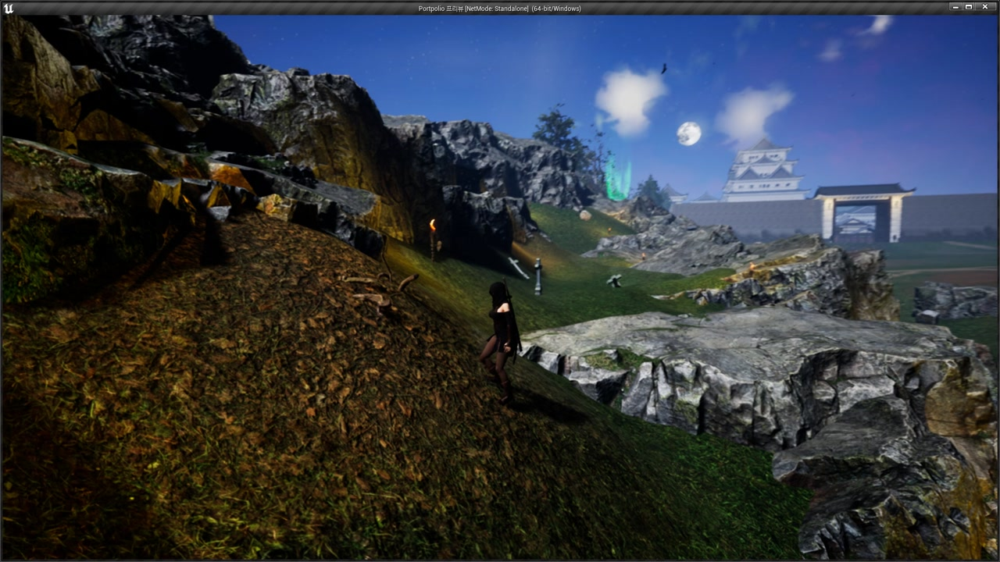
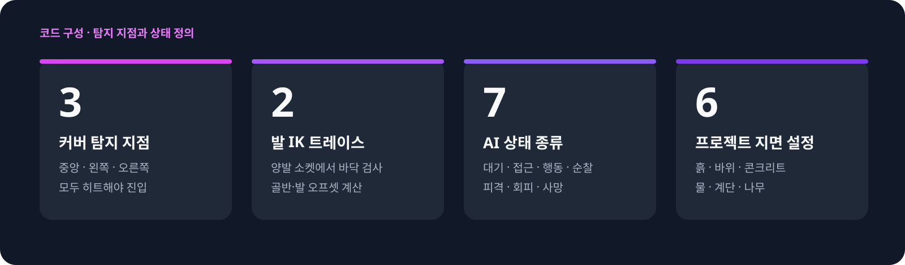
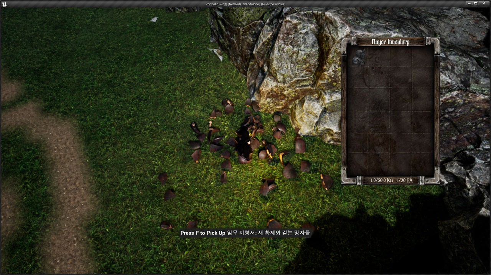
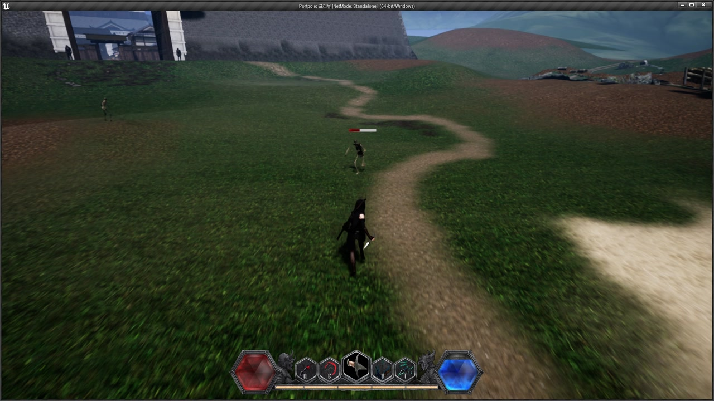
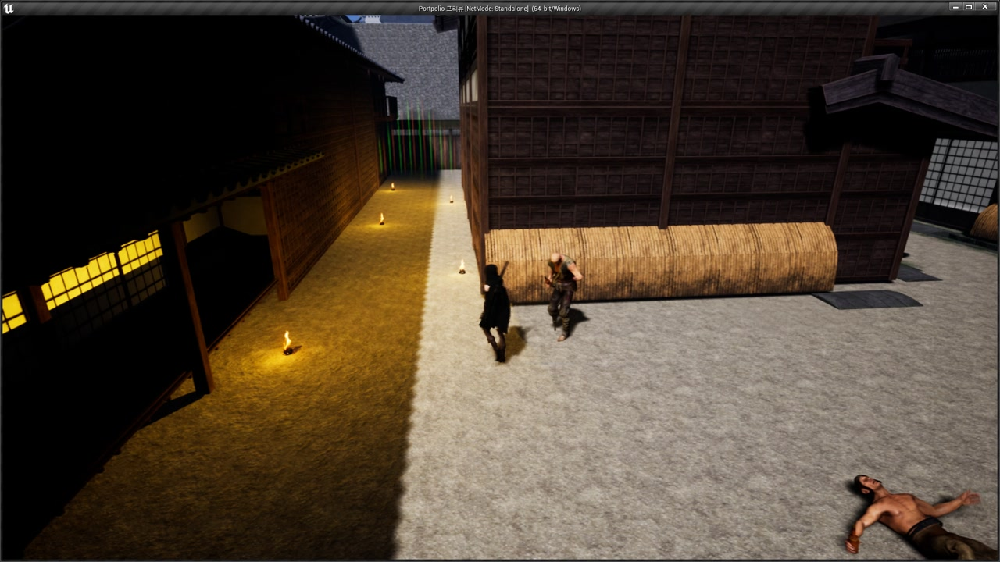
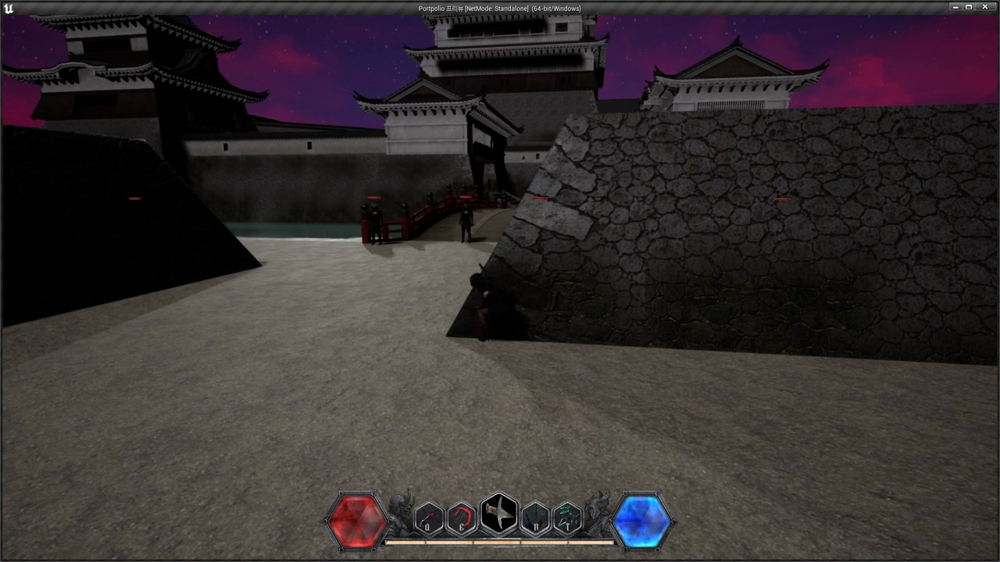
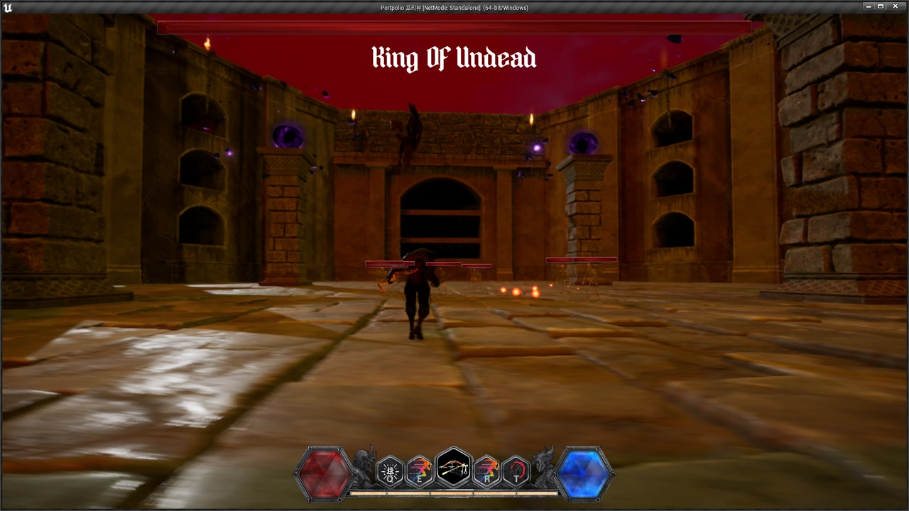
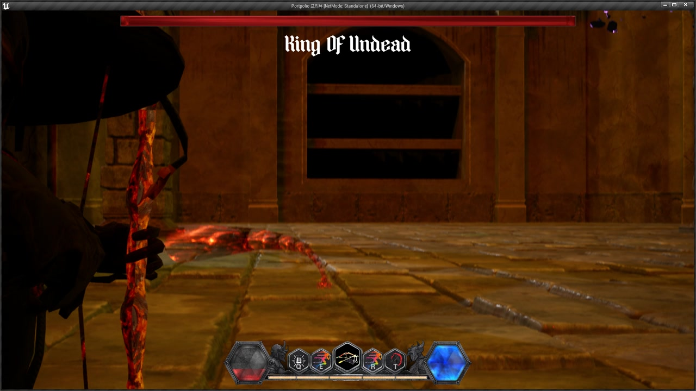
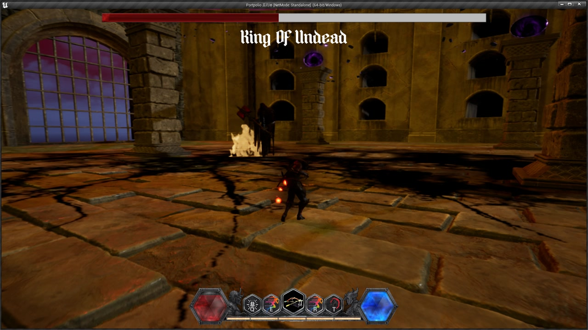

# Stealth Action RPG

첫 Unreal 프로젝트로 잠입, 커버 이동, 근접·원거리 전투와 보스전을 연결한 플레이 데모를 만들었습니다. Unreal Engine 4.27의 C++과 Blueprint로 혼자 개발했습니다.

  
  
  
  

[전체 플레이 영상](https://youtu.be/WUUj8kRv9-s)

## 프로젝트 요약

| 구분 | 내용 |
| --- | --- |
| 개발 | 1인 개발 |
| 공개 | 2024.05 |
| 담당 | 기획, 플레이어 제어, 전투, 커버, AI, UI 연결 |
| 결과물 | 탐색·잠입·전투·보스전을 포함한 플레이 데모 |

플레이어 제어와 전투를 구현하고 AI, 애니메이션, UI를 연결했습니다. 아래에는 커버 판정, 발 위치 보정, AI 상태 전환을 어떻게 처리했는지 정리했습니다.

그림의 숫자는 코드에 정의한 탐지 지점과 상태·지면 유형의 개수입니다. 성능을 측정한 결과는 아닙니다.

## 플레이 화면

<table>
  <tr>
    <td width="50%"></td>
    <td width="50%"></td>
  </tr>
  <tr>
    <td width="50%"></td>
    <td width="50%"></td>
  </tr>
  <tr>
    <td width="50%"></td>
    <td width="50%"></td>
  </tr>
</table>

## 구현하면서 다룬 문제

### 벽의 중앙과 양쪽을 확인한 뒤 커버에 진입하도록 했습니다

커버 진입 전에 캐릭터 중앙·좌·우에서 Sphere Sweep를 수행했습니다. 전방 한 지점만으로는 캐릭터 양쪽까지 벽이 있는지 판단할 수 없어, 세 지점이 모두 벽을 탐지해야 진입하도록 했습니다.

진입할 때는 충돌 지점과 벽의 법선으로 캐릭터 위치와 회전을 맞췄습니다. 커버 중에는 양옆의 벽을 다시 탐지해 이동 가능 여부와 벽 끝의 카메라 위치를 처리했습니다.

### 발 위치와 발소리를 각각 지면에 맞췄습니다

경사면에서 발이 지면에 닿도록 양발 위치 아래를 Line Trace로 검사했습니다. 지면까지의 거리로 발과 골반의 높이를 구하고, 바닥 법선으로 발의 회전을 보정했습니다. 파쿠르 동작 중에는 Feet IK를 끄도록 분기했습니다.

발소리는 발을 디디는 Anim Notify 시점에 별도로 지면을 검사했습니다. 검출한 Physical Material 이름으로 `TMap`에서 사운드를 골랐습니다. IK와 발소리는 검사 시점이 달라 각각 트레이스를 수행합니다.

### AI의 상태 판단과 공격 실행을 나눴습니다

Behavior Tree의 Service에서 타깃 유무, 거리, 피격 여부를 확인하고 Blackboard의 상태값을 바꾸도록 했습니다. 대기·접근·행동·순찰·피격·회피·사망을 enum으로 정의해 현재 상태 하나를 저장했습니다.

공격 Task에서는 이동을 멈추고 무기 행동을 실행했습니다. 공격이 끝나면 Task를 완료하고, 도중에 취소되면 행동을 종료하고 공격 순서를 초기화했습니다. 상태를 고르는 조건은 Service에서, 공격의 시작과 종료는 Task에서 확인할 수 있도록 나눴습니다.

## 코드에서 확인할 부분

- [커버 탐지·정렬·이동·카메라](Source/Portpolio/Components/CCoverSystemComponent.cpp)
- [양발 트레이스와 Feet IK 데이터](Source/Portpolio/Components/CFeetComponent.cpp)
- [Animation Instance의 IK 적용 조건](Source/Portpolio/Characters/CAnimInstance.cpp)
- [Physical Material 기반 발소리](Source/Portpolio/FootStep/CAnimNotify_FootStepSound.cpp)
- [Blackboard 기반 AI 상태](Source/Portpolio/Behavior/CAIBehaviorComponent.cpp)
- [거리·피격·타깃 상태 판단](Source/Portpolio/Behavior/Services/BTService_Range.cpp)
- [BT Action 실행·종료·취소](Source/Portpolio/Behavior/Tasks/BTTaskNode_Action.cpp)

## 첫 프로젝트에서 남은 한계

- 커버 컴포넌트에 탐지, 이동, 카메라, 애니메이션 상태가 모였습니다. 다시 만든다면 벽 탐지와 이동, 카메라 처리를 나누고 싶습니다.
- 검증은 Unreal Editor에서 장면별로 반복 플레이하는 방식이었고, 자동화 테스트는 없었습니다.
- 실행에 필요한 Blueprint과 상용·외부 에셋을 제외했기 때문에 이 공개본만으로는 프로젝트를 실행할 수 없습니다.

공개 코드와 에셋 제외 범위는 [NOTICE](NOTICE.md)에 적었습니다.
